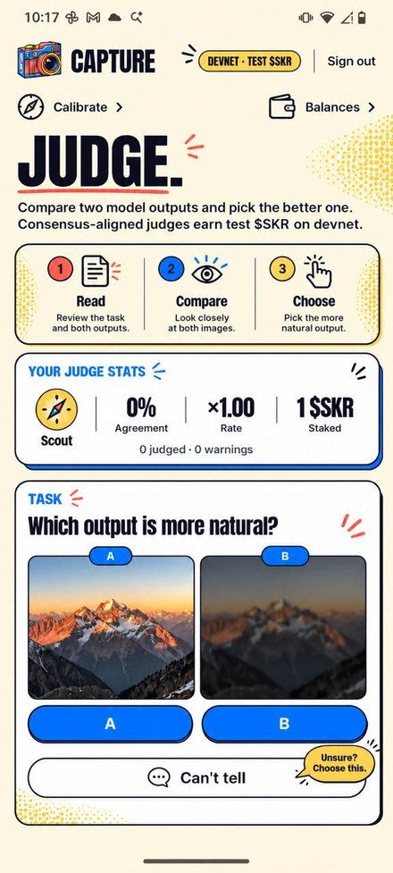
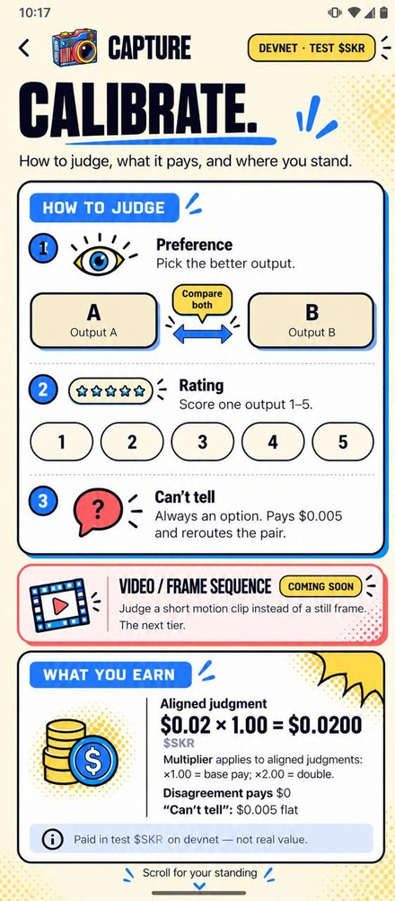
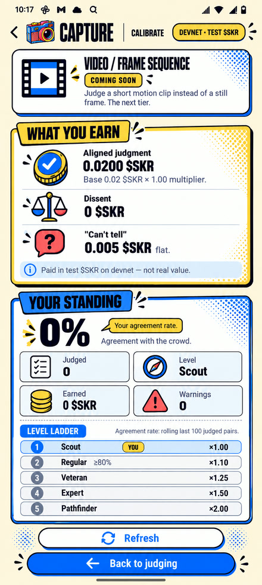
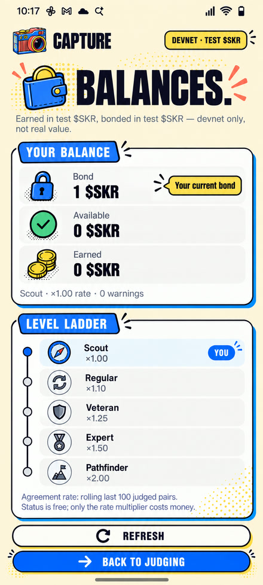

# Capture

**Humans judge model outputs. Consensus decides who gets paid in $SKR on Solana. Create a human verified data set for training robot vision.**

Capture is a decentralized RLHF platform for the Solana Seeker mobile. Contributors stake a $SKR bond, judge a vision model's outputs, and earn $SKR only when their judgment agrees with the crowd. Dissenters earn nothing, and systematic bad faith costs the bond. The result is an RLHF preference dataset with on-chain provenance, produced without a labeling firm and without guessing.

## What it does

- **Prove human.** On-device liveness and anti-spoofing (CameraX, ML Kit, LiteRT). No biometric data leaves the phone.
- **Stake.** A judge deposits a $SKR bond to unlock paid work.
- **Judge.** See two outputs, pick the better one (A/B), or rate one output 1 to 5. A two-second tap. "Can't tell" is always allowed and never forced.
- **Resolve.** Every pair goes to three judges. The majority pick wins.
- **Pay or slash.** Judges who agreed get paid $SKR. Judges who disagreed earn nothing. Systematic disagreement runs a two-strike warn-then-slash on the bond.
- **Anchor.** Each resolved batch commits a Merkle root on-chain, so every label traces to a bonded, consensus-aligned human judgment.

## The idea in one line

Consensus-gated pay makes farming unprofitable. A random tapper agrees with the crowd roughly half the time, so spam earns about half the base rate. The only reliable way to earn is to judge well. The bond adds skin in the game: bad faith has a real cost.

## Who it is for

- **Contributors.** Anyone with a phone who wants to earn $SKR for a two-second judgment.
- **AI teams and labs.** Anyone training a vision model who needs human preference data at scale, without paying enterprise labeling prices.

## Token

$SKR does three jobs: stake, reward, slash. One token. Payout and bond use the same token, so the loop is closed and self-funding.

## Deployment (devnet)

- Program: `5TiDwP86k95yfQWzExrPTj5qcKxED99z8pW9fN81u5SV`
- TEST $SKR mint: `3aGKaVL7GpcTcTuKjkyirnVeyNG1JGFNyGGueu8mAGbM`
- TEST Treasury (TEST $SKR mint authority): `4S7W4BJvxHu26cWZdw9cmrKRLDDpzQV2BGNo783NG8zS`

Tests: 63 backend, 7 Anchor, 64 Android. APK: 46.5 MB arm64 debug build.

## Status

Everything runs on **devnet test $SKR**, not real value. The app and the health endpoint both say so.

Honest notes:

- **Test tokens only.** Pay and bond are devnet test $SKR.
- **Majority-preference bias.** RLHF on majority preference flattens minority and edge preferences. The dataset does not claim to represent all humans.
- **Seed data.** The demo is seeded with placeholder image URLs. This proves the judging infrastructure, not a production dataset.

## Roadmap

- **Human Seeker NFT.** Depositing the $SKR bond mints an NFT as a certificate of human authenticity, so every bonded judge is a verified human.
- **$SKR swap.** An in-app swap so judges can move in and out of $SKR, with margin captured on the trade.
- **Video / frame-sequence judging.** Judge motion and sequence clips, not just still frames.
- **Vision-model data pipeline.** Integrate the judged dataset with a vision-model training pipeline, so accepted labels flow to training with on-chain provenance.
- **Hardware-backed attestation.** Move liveness from an on-device motion check to device attestation for stronger anti-spoofing.
- **Mainnet.** Move from devnet test $SKR to the production $SKR token.

## Install the app

The Solana Seeker client ships as a debug APK (devnet build, test tokens only). The same flows are available in the web app.

## App Design

| Judge | Calibrate | Standing | Balances |
|---|---|---|---|
|  |  |  |  |

## Repository layout

```
.
├── android/            Solana Seeker mobile app (Kotlin / Gradle)
├── backend/            FastAPI service
│   ├── seeker/         judgment API, consensus, bond, chain, DB
│   ├── migrations/     database migrations
│   └── tests/          backend test suite
├── programs/           Anchor workspaces
│   └── seeker-bounty/  on-chain SKR bond + warn/slash + batch-anchor program
├── scripts/            devnet bootstrap and demo helpers
├── docs/               API contract
└── .github/            CI workflows
```

## Quick start

Four commands from a fresh clone to a running backend (devnet, throwaway dev-only keys):

```bash
git clone https://github.com/chunli0x/captureforclockin.git && cd captureforclockin

# 1. PostgreSQL (Docker), loopback-only by default
docker compose up -d

# 2. venv + dependencies + dev-only keys + DB schema; writes backend/.env
./scripts/dev_bootstrap.sh

# 3. run the API (loads the generated backend/.env)
cd backend && .venv/bin/uvicorn seeker.api:production_app --factory --env-file .env

# 4. verify
curl -s http://localhost:8000/health
```

Notes:

- The backend listens on port 8000.
- `dev_bootstrap.sh` generates a dev-only verifier keypair and writes it to `backend/.env`. The real verifier key is never committed. Anything needing the real verifier on-chain will fail until you point `SEEKER_VERIFIER_KEY_FILE` at your own keypair.
- No Docker? Use SQLite: set `SEEKER_LOCAL_SQLITE=true` and `SEEKER_DATABASE_URL=sqlite:///./seeker.db`.
- The dependency set is tested on Python 3.11. On a newer minor, run `PYTHON=python3.11 ./scripts/dev_bootstrap.sh`.

## Build and test

```bash
# backend
cd backend && .venv/bin/python -m pytest -q

# Anchor program (Rust unit tests + BPF build)
cargo test -p seeker-bounty --lib
anchor build
```
